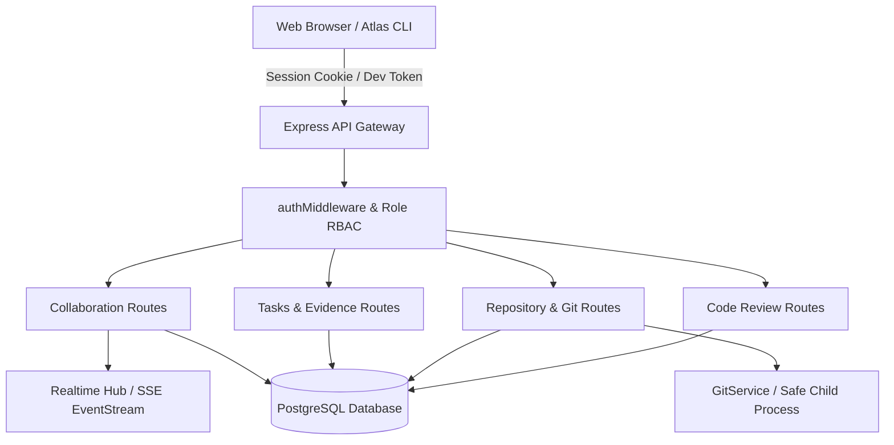

# Project Atlas / KRONOS — Team Collaboration Architecture

## 1. System Overview & Principles

Project Atlas / KRONOS is an enterprise-grade AI Developer Workspace engineered for high-velocity software engineering teams. The Collaboration Subsystem extends the single-player development workflow into an authenticated, multi-tenant multiplayer environment with:

- **Zero Mock Data Guarantee**: All members, roles, repositories, tasks, branches, commits, code reviews, comments, and telemetry are persisted in PostgreSQL and read from active system state.
- **Multi-Tenant Workspace Isolation**: Every query and mutation strictly enforces workspace boundaries. Client-supplied IDs are never trusted without cryptographic and database authorization.
- **Safe, Non-Destructive Git Integration**: Live Git repositories on the host system are queried via argument arrays with strict execution timeouts and path traversal defenses.
- **Real-Time Multiplayer Awareness**: Active presence, heartbeats, and real-time state changes are broadcast across the team via Server-Sent Events (SSE).

---

## 2. Core Entities and Data Schema

### 2.1 Workspace & Memberships
- `Workspace`: The tenant root containing all tasks, repositories, projects, documents, reviews, and activities. Supports creation, switching, and settings updating (`PATCH /api/collaboration/workspaces/:id`).
- `WorkspaceMember`: Associates a `User` with a `Workspace` under a defined `WorkspaceRole` (`OWNER`, `ADMIN`, `MEMBER`, `VIEWER`). Includes live presence detection and authentic assigned-work aggregation (`totalAssigned`, `completed`, `active` tasks) computed via database queries.
- `WorkspaceInvitation`: Secure, cryptographically random, expiring invitation token (`tokenHash`) with targeted email and assigned role. Unifies with document invitations under single-purpose token acceptance (`/api/invitations/accept`).

### 2.2 Shared Tasks & Collaborators
- `Task`: Core unit of work supporting:
  - Priority (`URGENT`, `HIGH`, `MEDIUM`, `LOW`)
  - Status lifecycle (`TODO` → `IN_PROGRESS` → `IN_REVIEW` → `DONE`)
  - Assignee (`assigneeId`) + Multi-collaborators (`TaskCollaborator`)
  - Repository association (`repositoryId`) and feature branch (`branchName`)
  - Structured acceptance criteria (`acceptanceCriteria`)
  - Verification evidence (`TaskEvidence`)
- `TaskComment`: Discussion thread with user mentions.
- `TaskActivity`: Audit log of transitions and assignments.

### 2.3 Code Reviews & Pull Requests
- `CodeReview`: Internal peer code review entity linking:
  - Repository (`repositoryId`)
  - Task (`taskId`)
  - Author (`authorId`)
  - Source branch (`sourceBranch`) and target branch (`targetBranch`)
  - Lifecycle (`DRAFT`, `OPEN`, `REVIEW_REQUESTED`, `CHANGES_REQUESTED`, `APPROVED`, `MERGED`, `CLOSED`)
- `CodeReviewComment`: File- and line-level diff comments.
- `CodeReviewAction`: Recorded review decisions (`APPROVE`, `REQUEST_CHANGES`, `COMMENT`, `CLOSE`, `REOPEN`).

### 2.4 Notifications & Realtime Presence
- `Notification`: In-app notification with read tracking and resource deep-linking.
- `WorkspaceActivity`: High-level timeline of events across the workspace.
- `RealtimeHub`: SSE pub/sub engine tracking connected sockets and distributing updates.

---

## 3. Role-Based Access Control (RBAC) Matrix

| Action | OWNER | ADMIN | MEMBER | VIEWER |
| :--- | :---: | :---: | :---: | :---: |
| Delete Workspace | Yes | No | No | No |
| Change Member Roles | Yes | Yes (<= Admin) | No | No |
| Remove Members | Yes | Yes (<= Member) | No | No |
| Send Workspace Invitations | Yes | Yes | Yes (MEMBER/VIEWER) | No |
| Connect / Disconnect Repositories | Yes | Yes | Yes | No |
| Create / Edit Tasks | Yes | Yes | Yes | No |
| Link Tasks to Repositories & Branches | Yes | Yes | Yes | No |
| Create / Submit Code Reviews | Yes | Yes | Yes | No |
| Approve / Request Changes on Reviews | Yes | Yes | Yes | No |
| Post Comments & Mentions | Yes | Yes | Yes | Yes |
| View Code, Tasks & Telemetry | Yes | Yes | Yes | Yes |

---

## 4. Git & Code Review Integration Workflow

1. **Task Association**: A developer claims a task and assigns a feature branch (e.g., `feature/payment-gateway`).
2. **Live Commits Discovery**: When the developer commits to their branch in the connected repository, Project Atlas's `GitService` reads live Git history, matching commits with `[TASK-id]` tags or branch metadata.
3. **Review Creation**: The developer initiates a Code Review from the feature branch to `main`.
4. **Diff Inspection & Comments**: Reviewers inspect real git diffs generated by `git diff target...source`, leaving inline or summary comments.
5. **Acceptance Verification**: Required checks and evidence (`TaskEvidence`) must pass before a task transitions from `IN_REVIEW` to `DONE`.
