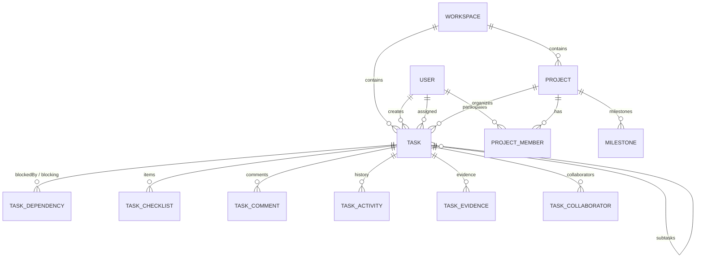

# Project Atlas / KRONOS — Tasks & Projects Architecture Specification

## 1. Executive Summary & Design Vision
The Project Atlas / KRONOS Tasks & Projects module is a developer-centric work orchestration engine designed for high-velocity software engineering teams. Built with a restrained, ultra-premium monochrome aesthetic (near-black `#080808`, deep graphite `#111216`, thin borders `#262626`, crisp white typography, and silver metadata), it combines the structured rigor of linear issue trackers with rich Git/terminal workflows, strict DAG dependency validation, and real-time state synchronization.

---

## 2. Core Entities & Relationships

### Entity Specifications

1. **Project (`projects`)**:
   - `id`: Stable CUID.
   - `workspaceId`: Foreign key to `Workspace` ensuring tenant isolation.
   - `creatorId`: Foreign key to `User`.
   - `name`: Human-readable initiative title (indexed).
   - `slug`: URL-friendly unique identifier.
   - `description`: Markdown/rich-text summary.
   - `color`: Hex color accent (defaults to monochrome palette).
   - `icon`: Unicode icon or glyph.
   - `status`: Enum (`PLANNING`, `ACTIVE`, `ON_HOLD`, `COMPLETED`, `ARCHIVED`).
   - `health`: Automated indicator (`ON_TRACK`, `AT_RISK`, `OFF_TRACK`).
   - `progress`: Integer `0..100` calculated deterministically from active root tasks:
     $$\text{progress} = \text{round}\left(\frac{\text{doneRootTasks}}{\text{totalRootTasks}} \times 100\right)$$
   - `startDate`, `targetDate`: Temporal boundaries.
   - `isArchived`: Boolean flag for non-destructive archiving.

2. **Task (`tasks`)**:
   - `id`: Canonical CUID (`TASK-xxxx`).
   - `workspaceId`: Tenant isolation foreign key.
   - `creatorId`, `assigneeId`: Ownership and accountability.
   - `projectId`: Optional initiative scope.
   - `milestoneId`: Optional target release alignment.
   - `parentId`: Optional reference to parent Task (enforcing hierarchical tree structure).
   - `title`, `description`: Technical requirements.
   - `status`: Strict state machine: `BACKLOG` → `TODO` → `IN_PROGRESS` → `IN_REVIEW` → `DONE` (plus `CANCELLED`).
   - `priority`: `URGENT`, `HIGH`, `MEDIUM`, `LOW`, `NONE`.
   - `dueDate`, `startDate`: Scheduling timestamps.
   - `estimatedHours`, `actualHours`: Capacity tracking.
   - `acceptanceCriteria`: JSON array of verifiable criteria.
   - `isVerified`: Boolean gate confirming test evidence recorded before `DONE`.
   - `isArchived`: Soft deletion state.

3. **Task Dependency (`task_dependencies`)**:
   - `blockingTaskId`: Predecessor task.
   - `blockedTaskId`: Successor task.
   - `type`: `FINISH_TO_START` (default).
   - **DAG Invariant**: Strict acyclic validation via breadth-first search graph traversal. Self-dependencies and cyclical deadlocks are rejected server-side.

4. **Task Collaborator (`task_collaborators`)**:
   - `taskId`, `userId`: Multi-assignee / peer reviewer mapping.

5. **Task Activity (`task_activities`)**:
   - Transactional audit log recording `TASK_CREATED`, `STATUS_CHANGED`, `PRIORITY_CHANGED`, `ASSIGNED`, `BLOCKED`, `COMPLETED`, `REOPENED`.

---

## 3. State Machines & Validation Invariants

### Task Completion Governance
A task cannot silently transition to `DONE` when:
1. **Active Predecessor Blockers**: One or more blocking tasks have `status !== 'DONE'`. Attempting to mark a blocked task `DONE` throws `TASK_BLOCKED`.
2. **Unfinished Subtasks**: A parent task with subtasks where any subtask has `status !== 'DONE'` throws `UNFINISHED_SUBTASKS`.
3. **Acceptance Criteria Verification**: Tasks configured with required checks require verification before closure.

### Project Health Rules
Calculated automatically when tasks are updated:
- `OFF_TRACK`: Overdue tasks $\ge 3$, or $\ge 2$ blocked tasks with project progress $< 80\%$.
- `AT_RISK`: Overdue tasks $\ge 1$ or blocked tasks $\ge 1$.
- `ON_TRACK`: Zero overdue tasks and zero blocked tasks.

---

## 4. UI Architecture & View Consistency
The task workspace maintains a single source of truth across all views:
- **Kanban Board**: Drag-and-drop status lanes with optimistic update and rollback upon API rejection.
- **List View**: Dense developer table with multi-column sorting, priority/status filtering, search, and inline navigation.
- **Project Manager**: High-level initiative dashboard with progress telemetry, health badges, milestone timelines, and archive controls.
- **Task Detail Slide-over Panel**: Canonical task identity, properties grid, checklist progress, criteria verification, subtasks tree, finish-to-start dependencies, and discussion comments.
- **In-App Terminal (`terminal-service.ts`)**: Fast CLI execution (`atlas task list`, `atlas task complete`) synced via Server-Sent Events (SSE).
